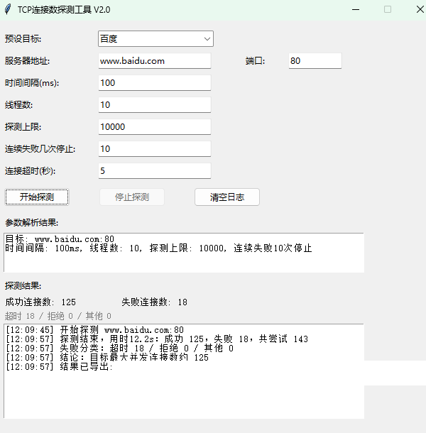

# TCP 连接数探测工具

用于测试一条网络路径上的 TCP 并发连接能力。客户端反复建立 TCP 连接并保持成功连接，记录成功数、失败数和失败类型；服务端提供 TCP Echo 和状态统计接口。

> 只对自己拥有或已获授权的目标进行测试。公共 DNS、网站等服务不应作为高并发压力测试目标。测试结果同时受目标服务、客户端、路由器、NAT 和防火墙限制，成功连接数不一定等于某台设备的理论上限。

## 版本与下载

GitHub Actions 构建成功后会创建一个 Release，提供两个 Windows 图形客户端：

| Release 文件 | 实现 | 运行要求 |
|---|---|---|
| `TcpSessionTester.exe` | C# WinForms，目标框架 .NET Framework 4.8 | Windows 11 [自带 .NET Framework 4.8 或 4.8.1](https://learn.microsoft.com/dotnet/framework/install/)，无需另装运行时；EXE 不捆绑运行时 |
| `TcpSessionTester-Python.exe` | Python 图形版，由 PyInstaller 打包 | Windows，无需另装 Python |

Python 源码也可直接运行：命令行版适用于 Windows、macOS 和 Linux；图形版适用于有桌面环境且安装了 Tkinter 的系统。源码位于 `client/`。

## 功能

- 按指定间隔和线程数建立 TCP 连接，并保持成功连接。
- 设置单次连接超时、探测上限和连续失败停止阈值。
- 实时查看成功、失败、在途连接及超时、拒绝和其他失败数。
- 手动停止或达到停止条件时立即释放已建立的连接。
- 自动导出 CSV 探测结果。
- Windows C# 图形版显示系统中活动 TCP 连接较多的进程（IPv4）。

停止时客户端使用零等待关闭（RST）释放连接。客户端不发送应用层数据；服务端的 Echo 端口用于接收和回显数据，状态接口用于查看连接和字节统计。



*示例截图为 V2.0 界面；其中显示的参数和结果是截图时的数据。*

## 快速开始：启动测试服务端

推荐使用自己控制的服务端进行并发测试。Docker 镜像已发布到 GitHub Container Registry：

```bash
docker run -d --name tcp-test --restart unless-stopped \
  -p 9000:9000 -p 9001:9001 \
  --ulimit nofile=65535:65535 \
  ghcr.io/panyong29/tcp-session-server:latest
```

| 端口 | 用途 |
|---|---|
| `9000` | TCP Echo 测试端口 |
| `9001` | HTTP 状态接口：`GET /stats` |

查看服务端统计：

```bash
curl http://127.0.0.1:9001/stats
```

可通过环境变量修改端口：

```bash
docker run -d --name tcp-test \
  -p 9000:9000 -p 9001:9001 \
  -e TCP_PORT=9000 -e STATS_PORT=9001 \
  ghcr.io/panyong29/tcp-session-server:latest
```

从源码构建服务端镜像：

```bash
docker build -t tcp-session-server ./server
```

## Windows 图形客户端

### C# 版

从仓库的 [Releases](../../releases) 下载 `TcpSessionTester.exe`，解压后双击运行。它面向 Windows 11，目标框架为 .NET Framework 4.8；运行时由 Windows 提供，未打包进 EXE。

从源码构建：

1. 使用 Visual Studio 打开 `client/winforms-net48/TcpSessionTester.csproj`。
2. 选择 .NET Framework 4.8 目标框架和 `Release` 配置。
3. 生成的程序位于 `client/winforms-net48/bin/Release/TcpSessionTester.exe`。

### Python 版

从 [Releases](../../releases) 下载 `TcpSessionTester-Python.exe`，或使用 Python 源码运行图形版：

```powershell
python client/tcp_client.py
```

源码运行需要 Python 3.12 和 Tkinter。PyInstaller 发布版已包含 Python 运行环境。

## Python 命令行客户端

`client/tcp_cli.py` 不依赖第三方 pip 包，使用 Python 3.12 即可运行。

克隆仓库并进入项目目录：

```bash
git clone https://github.com/panyong29/tcp-session-tester.git
cd tcp-session-tester
```

用预设目标测试：

```bash
python3 client/tcp_cli.py --preset tencent
```

连接自有服务端：10 个线程、每线程间隔 100ms、最多尝试 5000 次、连续失败 20 次后停止：

```bash
python3 client/tcp_cli.py --host 127.0.0.1 --port 9000 \
  --threads 10 --interval-ms 100 --max-probe 5000 --max-fail 20
```

运行 60 秒并导出 CSV：

```bash
python3 client/tcp_cli.py --host 127.0.0.1 --port 9000 \
  --duration 60 --csv result.csv
```

查看所有预设和参数：

```bash
python3 client/tcp_cli.py --list-presets
python3 client/tcp_cli.py --help
```

### 命令行参数

| 参数 | 默认值 | 说明 |
|---|---:|---|
| `--host`、`--port` | 无 | 目标服务器地址和端口；必填，或使用 `--preset` |
| `--preset` | 无 | 预设目标：`ali`、`google`、`cloudflare`、`tencent`、`baidu` |
| `--threads` | `10` | 工作线程数，范围 1–200 |
| `--interval-ms` | `100` | 每个工作线程两次连接尝试之间的间隔，毫秒 |
| `--max-probe` | `10000` | 最大连接尝试次数 |
| `--max-fail` | `100` | 连续失败达到该次数后停止 |
| `--timeout` | `5` | 单次连接超时，秒 |
| `--duration` | `0` | 测试时长，秒；`0` 表示不限时 |
| `--refresh-ms` | `200` | 终端状态刷新间隔，毫秒 |
| `--csv` | 无 | CSV 导出路径；未指定时不导出 |

测试期间按 `Ctrl+C` 可停止。终端会显示尝试数、成功数、失败数、当前保持数、失败分类、用时和平均尝试速率。输出被重定向到文件时，每次刷新会输出一行。

## macOS / Linux 图形客户端

图形版源码为 `client/tcp_client.py`，需要 Python 3.12、Tkinter 和桌面会话；不需要安装第三方 pip 包。

Ubuntu / Debian 安装依赖：

```bash
sudo apt install python3 python3-tk
```

Fedora 可安装 `python3-tkinter`。macOS 可使用 python.org 的 Python 安装包；Homebrew Python 缺少 Tkinter 时，安装对应版本的 `python-tk`。

运行前可用以下命令确认 Tkinter 可用：

```bash
python3 -m tkinter
```

运行图形版：

```bash
python3 client/tcp_client.py
```

若高并发测试遇到 `Too many open files`，可在同一终端提高文件描述符上限：

```bash
ulimit -n 65535
python3 client/tcp_client.py
```

可选：打包当前平台的图形版程序：

```bash
pip install pyinstaller
pyinstaller --onefile --windowed --name TcpSessionTester client/tcp_client.py
```

## 测试宽带或 NAT 会话能力

1. 在自有或获准使用的公网 VPS 上启动本项目服务端。
2. 客户端连接 VPS 的 TCP `9000` 端口。
3. 从较低并发和较慢的建连速率开始，逐步增加负载。
4. 对照客户端结果与服务端 `/stats`，观察成功连接是否下降、超时是否增加。
5. 在网络空闲时重复测试，并比较直连和经过路由器、防火墙的结果。

测试成功数会受到服务端连接限制、建连速率、单次超时、客户端端口资源以及网络中间设备的共同影响。它是当前测试路径上的观测值，不应直接当作某台设备的固定规格。CLI 可用 `--duration` 限定时长；图形版可手动停止。

## 注意事项

- 不要对未经授权的公网服务进行高并发测试；过快建连可能触发限流或封禁。
- 连接失败可能来自超时、拒绝、客户端端口耗尽、目标服务限制或 NAT/防火墙丢弃。单一目标的结果不能独立证明是路由器上限。
- Windows 和 Linux/macOS 的临时端口范围、文件描述符上限都可能限制客户端可建立的连接数。
- Windows 进程连接数面板读取系统 IPv4 TCP 表；非 Windows 的 Python 图形版不提供该系统级面板。
- 停止时使用 RST 关闭连接，不执行带数据的优雅关闭；本工具仅用于不发送应用层数据的连接探测。
