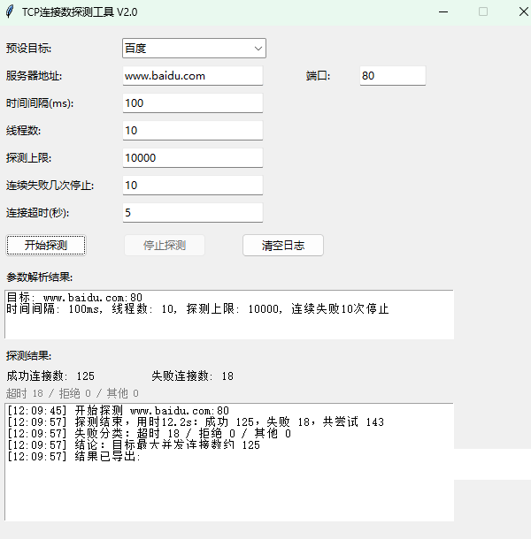

# TCP 会话数测试小工具

测目标 TCP 服务能扛住多少并发会话。服务端跑在 Docker 里，客户端有三种用法：Windows 有现成 exe，macOS / Linux 终端用命令行版，桌面环境也可以跑图形版源码，填上服务器地址、端口、并发数就能测。



百度预设实测（V2.0 界面，布局与现版相同）：间隔 100ms、线程 10、探测上限 10000、连续失败 10 次停、超时 5 秒，结果成功 125、失败 18（超时 18 / 拒绝 0 / 其他 0），共尝试 143。日志里的 CSV 导出路径已脱敏。

## 服务端（Docker）

镜像已发布到 ghcr.io，一行命令启动：

```bash
docker run -d --name tcp-test --restart unless-stopped \
  -p 9000:9000 -p 9001:9001 \
  --ulimit nofile=65535:65535 \
  ghcr.io/panyong29/tcp-session-server:latest
```

- `9000`：测试流量端口（TCP echo，收到什么返回什么）
- `9001`：状态接口，`curl http://127.0.0.1:9001/stats` 看累计连接数、当前活跃数、收发字节
- 端口可用环境变量改：`-e TCP_PORT=9000 -e STATS_PORT=9001`

自己构建：

```bash
docker build -t tcp-session-server ./server
```

## 客户端（Windows）

从 [Releases](../../releases) 页下载 `TcpSessionTester.exe`，双击运行。

## 客户端（命令行版，macOS / Linux）

终端用户推荐用命令行版 `client/tcp_cli.py`：clone 下来就能直接跑，不需要 pip 装任何东西，不需要 tkinter，不需要打包，Python 3.12 就够。

```bash
git clone https://github.com/panyong29/tcp-session-tester.git
cd tcp-session-tester

# 用预设目标
python3 client/tcp_cli.py --preset tencent

# 自己填目标：10 线程、间隔 100ms、最多探 5000 个、连续失败 20 次停
python3 client/tcp_cli.py --host 127.0.0.1 --port 9000 \
  --threads 10 --interval-ms 100 --max-probe 5000 --max-fail 20

# 测 60 秒就停，并把结果写进 CSV
python3 client/tcp_cli.py --preset tencent --duration 60 --csv result.csv

# 看有哪些预设、看全部选项
python3 client/tcp_cli.py --list-presets
python3 client/tcp_cli.py --help
```

| 选项 | 说明 |
|---|---|
| `--host` / `--port` | 服务器地址 / 端口，例如 `127.0.0.1` / `9000` |
| `--preset` | 预设目标：`ali` / `google` / `cloudflare` / `tencent` / `baidu`，不填 `--host` / `--port` 时用预设的地址端口 |
| `--threads` | 线程数，默认 10 |
| `--interval-ms` | 每次建连尝试之间的间隔（毫秒），默认 100 |
| `--max-probe` | 探测上限：最多尝试多少个连接，默认 10000 |
| `--max-fail` | 连续失败几次自动停止，默认 100 |
| `--timeout` | 单次建连超时（秒），默认 5 |
| `--duration` | 测定时长（秒），0 表示不限时，默认 0 |
| `--refresh-ms` | 终端实时刷新间隔（毫秒），默认 200 |
| `--csv` | 结果 CSV 路径，不填则不写文件 |

探测过程中终端会原地实时刷新：已尝试、成功、失败、当前保持、失败分类（超时 / 拒绝 / 其他）、用时、平均建连速率。按 Ctrl+C 随时停止，探测上限到了、连续失败到了阈值、测定时长到了都会自动停止；手动停止和自动停止都会立即释放全部连接（v2.3 起关闭用 RST，不进 TIME_WAIT），结束时打印最终汇总和停止原因。

注意：clone 下来的 `tcp_cli.py` 权限是 644，不能直接 `./client/tcp_cli.py` 运行，要用上面这种 `python3 client/tcp_cli.py` 的形式；想用 `./` 形式就先跑一次 `chmod +x client/tcp_cli.py`。重定向到文件时不会用 ANSI 清屏，会改成每刷新一次打印一行。

## 客户端（图形版，macOS / Linux）

想要图形界面时，macOS / Linux 没有现成 exe，直接跑图形版源码，界面、参数、用法和 Windows 版完全一样（停止 / 自动停止都会立即释放连接，v2.3 起关闭用 RST，不进 TIME_WAIT）。

### 1. 准备 Python 和 tkinter

需要 Python 3.12，客户端除标准库外不依赖任何 pip 包。tkinter 不能用 pip 装（它不是 PyPI 上的包），要走系统包或官方安装包：

- macOS：从 python.org 下载的安装包自带 tkinter；如果是 Homebrew 装的 Python，`python3 -m tkinter` 报错时再补装对应版本，例如 Python 3.12 就装 `brew install python-tk@3.12`（把 3.12 换成你自己的 Python 版本）。
- Linux（Ubuntu / Debian）：

  ```bash
  sudo apt install python3 python3-tk
  ```

  其他发行版装对应的 tkinter 包即可，例如 Fedora 是 `python3-tkinter`。

先验证 tkinter 能用，弹一个测试窗口才算过关：

```bash
python3 -m tkinter
```

### 2. 拿到源码并运行

```bash
git clone https://github.com/panyong29/tcp-session-tester.git
cd tcp-session-tester
python3 client/tcp_client.py
```

也可以在 GitHub 仓库页点 Code → Download ZIP，解压后同样跑 `python3 client/tcp_client.py`。

注意要在桌面会话里跑，不能在没有图形界面的 SSH 里跑，否则会报没有显示设备（no display）。结果 CSV 的导出位置和 Windows 版一样：有桌面文件夹就导到桌面，没有就导到用户主目录。

### 3. 测大并发前先看文件描述符上限

客户端每保持一个连接就占一个文件描述符，测几千并发时如果报 `Too many open files`，先在同一个终端里调大再跑：

```bash
ulimit -n 65535
python3 client/tcp_client.py
```

### 可选：自己打一个单文件程序

```bash
pip install pyinstaller
pyinstaller --onefile --windowed --name TcpSessionTester client/tcp_client.py
```

产物在 `dist/` 目录下，之后双击它就能用，不用每次都敲命令。

参数说明：

| 参数 | 说明 |
|---|---|
| 服务器地址 / 端口 | 服务端 IP 或域名 + TCP 端口 |
| 时间间隔(ms) | 每次建连尝试之间的间隔 |
| 线程数 | 同时建连的工作线程数 |
| 探测上限 | 最多尝试多少个连接 |
| 失败多少次停止探测 | 连续失败达到该次数自动停止 |
| 连接超时 | 单次建连超时秒数 |
| 预设目标 | 一键切换测试目标：阿里DNS (223.6.6.6:53)、Google DNS (8.8.8.8:53)、Cloudflare DNS (1.1.1.1:53)、腾讯DNS (119.29.29.29:53)、百度 (www.baidu.com:80)、我的服务器，或自定义 |

探测逻辑：多线程持续建连并保持，失败数达阈值或达探测上限时自动停止，成功连接数即目标的最大并发连接数。

界面实时显示：已尝试 / 成功 / 失败 / 当前活跃 / 平均建连耗时，日志框记录过程。

## 典型用法：测宽带 TCP 会话上限

家用宽带的光猫/路由器都有 NAT 会话表上限（常见的几千到一万），运营商也可能限制。测试方法：

1. 服务端跑在公网 VPS 上（见上）
2. 家里电脑运行客户端，服务器地址填 VPS 的公网 IP，端口 9000
3. 并发连接数从 2000 起测，保持 60 秒
4. 逐步加大（4000 → 8000 → 12000…），观察"失败"数何时开始明显上升
5. 失败率突增的那个并发数，就是这条宽带实际的 TCP 会话上限

建议在用网低峰期测；建连速率别设太高（200~500/秒），太猛会被误判为攻击。

## 注意事项

- 客户端本机也有上限：Windows 动态端口约 1.6 万个；v2.3 之前大量短连接会遇到 TIME_WAIT 占端口，v2.3 起停止 / 自动停止用 RST 关闭，不进 TIME_WAIT；测上万并发建议把客户端也放 Linux 上跑，或调大动态端口范围
- 测公网服务器前先确认对方允许，避免被当成攻击封 IP
- 经过 NAT/防火墙测试时，关注的往往是中间设备的会话表是否被打满，可对比直连和经过设备的数据
